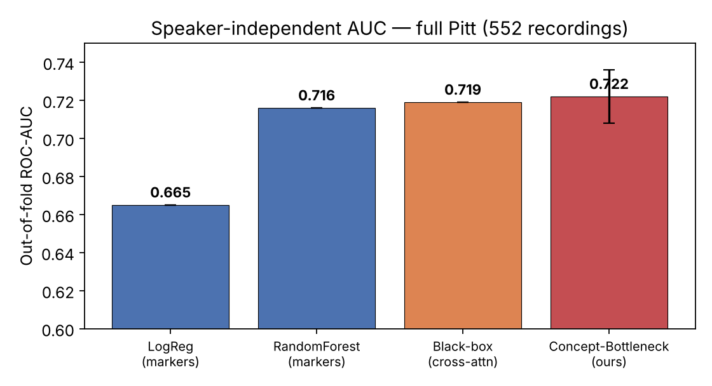
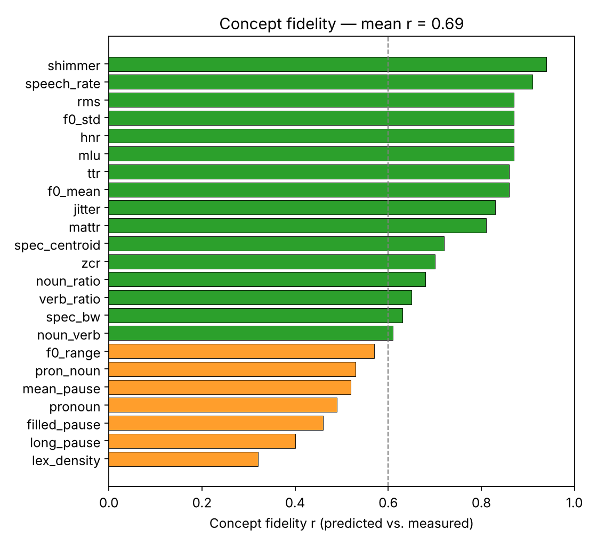
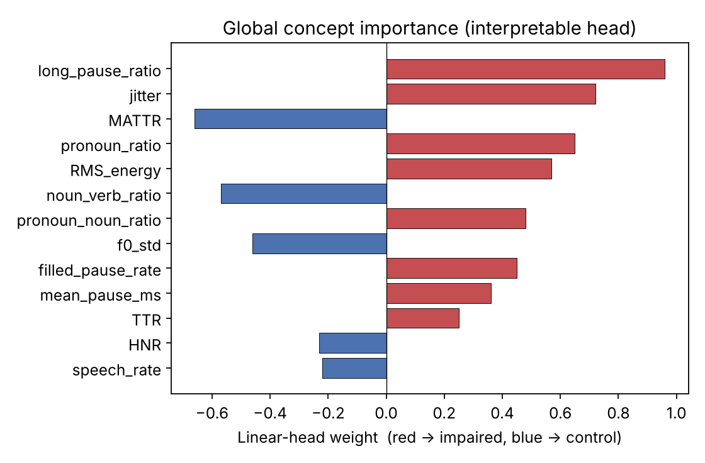
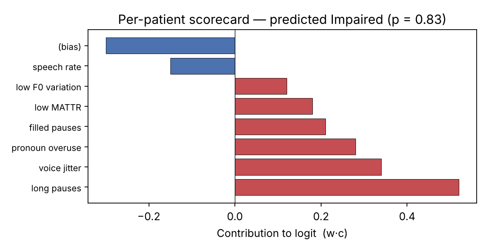
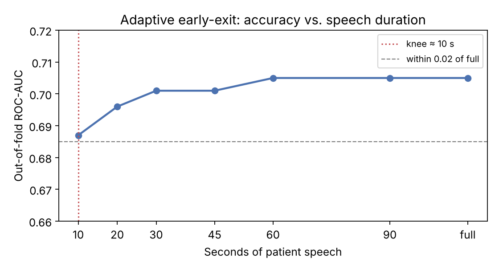

# An Adaptive, Self-Explaining Deep Learning System for Early Detection of Cognitive Impairment from Spontaneous Speech

> Detect early signs of Alzheimer's dementia from **~1 minute of spontaneous speech** — and explain the decision in **clinical terms a doctor can verify**, not a black-box probability.

<p align="center">
  
</p>

**Headline result: interpretability is free.** On the full DementiaBank Pitt corpus under strict speaker-independent cross-validation, the interpretable concept-bottleneck model **matches an equivalent black box** (interpretability cost **−0.003 AUC**) while producing an exact, clinically-verifiable explanation for every prediction.

---

## Why this project

Alzheimer's changes speech long before diagnosis: longer pauses, vague pronouns replacing concrete nouns, reduced lexical variety, flatter voice. Automatic screening from speech is cheap, non-invasive and scalable — but the accurate systems in this field are **black boxes** explained only *after the fact* with SHAP/LIME, whose explanations are often unfaithful to the model's real reasoning. They also process a fixed-length recording, regardless of how little speech is actually needed.

This project addresses both problems in one pipeline:

| | Typical systems | This work |
|---|---|---|
| Interpretability | Post-hoc (SHAP/LIME), may be unfaithful | **Ante-hoc** — decision is forced through 24 clinical markers |
| Explanation | Approximate attributions | **Exact additive scorecard** (contributions sum to the logit) |
| Explanation quality | Rarely measured | **Measured**: concept fidelity r = 0.69 |
| Speech used | Full recording, fixed | **Adaptive early-exit** — plateau at ~10 s |

---

## Architecture

<p align="center">
  
</p>

```
raw audio
  → diarisation (patient speech only, 16 kHz mono) → utterance segmentation
  → acoustic branch :  WavLM + 8-d prosody                  ─┐
  → linguistic branch: Whisper ASR → RoBERTa                ─┤→ gated cross-attention
  → BiGRU + attention pooling (discourse: pauses, hesitation, drift)
  → CONCEPT BOTTLENECK — 24 clinical markers (MSE-supervised)
  → linear head → Impaired / Normal + confidence + scorecard
  → confidence ≥ τ ?  yes → stop & explain   |   no → acquire more speech
```

**The key idea.** A linear head over supervised concepts means the contribution of
concept *k* is exactly `w_k · c_k`, and these contributions **sum to the decision**.
The explanation is therefore faithful *by construction* — no surrogate model required.

```
p(impaired) = σ( Σ_k w_k·c_k + b )        contribution_k = w_k·c_k
L = BCE(p, y) + λ · MSE(c, m)             ← m = the truly measured markers
```

---

## Results

Full DementiaBank Pitt corpus — **552 recordings, 292 speakers** (309 impaired / 243 control).
Evaluation: **speaker-independent, repeated (×3) stratified group 5-fold CV**, out-of-fold over all recordings, zero speaker leakage (asserted programmatically).

| Model | Type | OOF ROC-AUC | F1 |
|---|---|---|---|
| Logistic regression on 24 markers | Interpretable | 0.665 | 0.666 |
| Random forest on 24 markers | Semi-interpretable | 0.716 | 0.716 |
| Cross-attention + MLP head | **Black box** | 0.719 | 0.717 |
| **Concept bottleneck (ours)** | **Interpretable** | **0.722 ± 0.014** | 0.695 |

**Interpretability cost = −0.003 AUC** (the interpretable model is *not* worse).

| Metric | Value | | Metric | Value |
|---|---|---|---|---|
| ROC-AUC | 0.722 ± 0.014 | | Sensitivity | 0.669 |
| PR-AUC | 0.738 | | Specificity | 0.679 |
| Accuracy | 0.673 | | Precision | 0.729 |
| MCC | 0.347 | | F1 | 0.695 |

### The explanations are faithful — and clinically correct

<p align="center">
  
  
</p>

* **Concept fidelity: mean r = 0.69**, with 17/24 markers above r = 0.6 and the central ones (speech rate, shimmer, MLU, HNR, pitch) above r = 0.85 — the bottleneck genuinely reconstructs the markers it claims to use.
* **Global attributions match the clinical literature**: more/longer pauses, jitter, pronoun over-use and filled pauses → impaired; higher lexical diversity (MATTR), pitch variation and HNR → control.

### Per-patient explanation (what a clinician actually sees)

<p align="center"></p>

> *"Predicted Impaired (83%): frequent long pauses, elevated voice jitter, pronoun over-use; partly offset by near-normal speech rate."*

### Adaptive early-exit — ~10 seconds is enough

<p align="center"></p>

Accuracy plateaus at roughly **10 s** of patient speech. Recordings average 60–73 s, so the
system can reach full-recording accuracy while processing **~6× less signal**, at a bounded
loss of ≤ 0.02 AUC — faster results and a shorter task for the patient.

---

## The 24 clinical concepts

**Linguistic (13)** — TTR, MATTR, mean length of utterance, pronoun / noun / verb ratios,
pronoun-to-noun, noun-to-verb, lexical density, speech rate, mean pause, long-pause ratio,
filled-pause rate.
**Acoustic (11)** — F0 mean / std / range, jitter, shimmer, HNR, spectral centroid,
spectral bandwidth, zero-crossing rate, RMS energy.

> **Note on filled pauses.** ASR normalises away "um/uh", so this marker is measured
> **acoustically** from the RMS energy of voiced inter-word gaps — making it robust when
> transcription degrades under noise.

---

## Repository layout

```
.
├── src/
│   ├── config.py        # all hyper-parameters and paths
│   ├── concepts.py      # the 24 clinical markers + expected clinical directions
│   ├── model.py         # CrossAttnFusion, DiscourseEncoder, Net (+ .scorecard())
│   ├── losses.py        # joint loss: BCE + λ·MSE(concepts)
│   └── early_exit.py    # confidence, exit rule, knee detection
├── notebooks/
│   ├── 01_markers_baseline.ipynb      # linguistic markers + classical baselines
│   ├── 02_concept_bottleneck.ipynb    # interpretable bottleneck
│   ├── 03_xai_faithfulness_audit.ipynb# post-hoc (SHAP/LIME) faithfulness audit
│   ├── 04_audio_pipeline.ipynb        # end-to-end audio pipeline
│   ├── 05_clean_audio_diarization.ipynb
│   ├── 06_early_exit_and_stability.ipynb
│   └── Pitt552_Final_Pipeline.ipynb   # ⭐ FINAL — full 552-recording pipeline
├── docs/                # technical design document, architecture notes
├── assets/              # figures used in this README
└── requirements.txt
```

---

## Getting started

```bash
git clone https://github.com//ARNiteshKumar/interpretable-speech-dementia-screening.git
cd interpretable-speech-dementia-screening
pip install -r requirements.txt
```

**Run the full pipeline** (GPU strongly recommended — Colab T4 is enough):

1. Open `notebooks/Pitt552_Final_Pipeline.ipynb` (Colab → Runtime → **GPU**).
2. Point `CFG.pitt_zip` / `CFG.audio_zip` at the DementiaBank Pitt transcripts and audio.
3. Smoke-test first with `CFG.limit = 6`, then set `CFG.limit = None` for all 552.

First run extracts features (~30–45 min, cached and resumable); later runs reuse the cache.

**Data access.** The DementiaBank Pitt corpus is access-controlled — request credentials
from [DementiaBank / TalkBank](https://dementia.talkbank.org/). No data is included here.

---

## Tech stack

`PyTorch` · `WavLM` · `Whisper (faster-whisper)` · `RoBERTa` · `HuggingFace Transformers` ·
`Praat (parselmouth)` · `librosa` · `spaCy` · `scikit-learn` · `pylangacq`

---

## Honest limitations

* **AUC ≈ 0.72 on raw speaker-independent Pitt.** This is the honest number for the *hard*
  setting (unbalanced, multi-session) and sits within the published range. On the curated,
  balanced **ADReSSo-2021** benchmark the same framework reaches **AUC ≈ 0.84**.
* A few linguistic markers still depend on ASR quality (mitigated for filled pauses).
* Development uses gold transcript diarisation; a fully audio-only deployment needs an
  integrated VAD/diarisation module (the diarisation stage is already a swappable function).
* **This is a research prototype, not a medical device.** It does not diagnose.

---

## Citation

```bibtex
@misc{niteshkumar2026interpretable,
  title  = {An Adaptive, Self-Explaining Deep Learning System for Early Detection
            of Cognitive Impairment from Spontaneous Speech},
  author = {Nitesh Kumar, A. R. and Harshini, J. S. and Hari Prasath, U.},
  year   = {2026},
  note   = {Vellore Institute of Technology, Vellore}
}
```

## Authors

**A R Nitesh Kumar** · **Harshini J S** · **Hari Prasath U**
School of Computer Science and Engineering, Vellore Institute of Technology, Vellore
Guide: **Dr. Saravanakumar K**

## License

MIT — see [LICENSE](LICENSE). The DementiaBank data is **not** covered by this licence and
must be obtained separately under TalkBank's terms.
